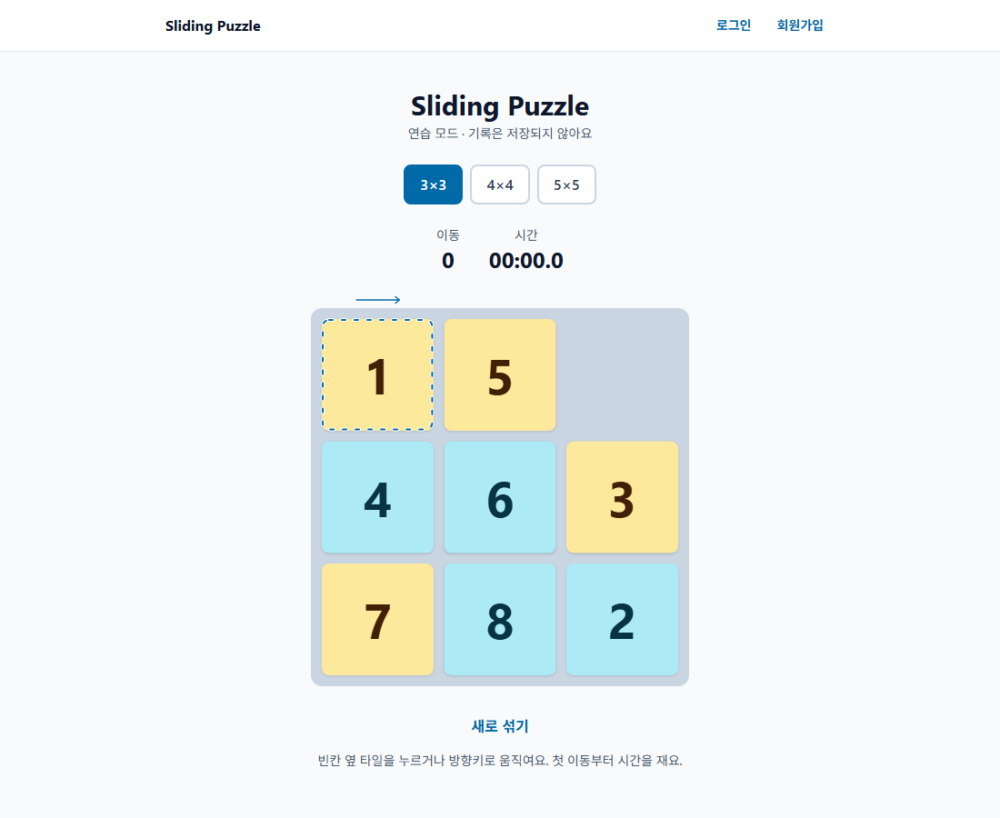
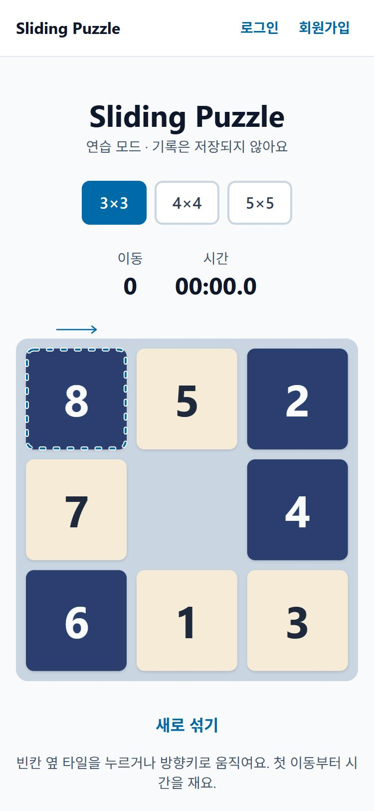
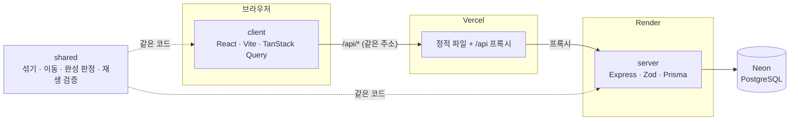

# Sliding Puzzle

3×3~5×5 슬라이딩 퍼즐을 풀고, 로그인한 사용자의 **개인 기록과 성장 통계**를 저장해 보여주는 풀스택 웹 게임입니다.
클라이언트가 보낸 기록을 그대로 믿지 않고, **서버가 이동 기록을 처음부터 다시 재생해서 검증한 뒤** 저장합니다.

**배포**: https://sliding-puzzle-ashy-sigma.vercel.app

<p>
  
  
</p>

새 게임마다 타일 색 디자인이 바뀌고, 왼쪽 위 1번 칸에는 시작 위치를 알려 주는 점선과 진행 방향 화살표가 있습니다.

| Lighthouse | 성능 | 접근성 | 권장 사항 | SEO |
| ---------- | ---- | ------ | --------- | --- |
| 모바일     | 99   | 100    | 100       | 100 |
| 데스크톱   | 100  | 100    | 100       | 100 |

(배포 사이트 첫 화면 기준. 첫 측정의 권장 사항 96, SEO 82에서 콘솔 오류·페이지 설명·`robots.txt`를 고쳐 올렸습니다.)

## 주요 기능

- **퍼즐 플레이**: 3×3 / 4×4 / 5×5 크기 선택, 타일 클릭과 방향키 조작, 이동 횟수·타이머, 완성 화면
- **풀 수 있는 퍼즐만 출제**: 완성 상태에서 시드 기반으로 합법적인 이동을 반복해 섞기
- **타일 색 디자인 8종**: 그라데이션 4종과 체크무늬 4종을 새 게임마다 무작위로 바꿈. 색은 타일의 원래 자리 기준이라 위치 힌트가 됨
- **연습 모드 / 기록 모드**: 로그인하지 않으면 브라우저에서만 플레이, 로그인하면 기록 저장
- **회원가입·로그인**: bcrypt 비밀번호 해시, httpOnly 쿠키 JWT
- **서버 측 기록 검증**: 이동 기록 재생, 이동 횟수 서버 계산, 비현실적인 시간 차단, 이중 제출 방지
- **내 기록 페이지**: 크기별 최고 기록·평균·완료율 카드, 최근 7일 추이 차트(표로 보기 포함), 기록 목록·삭제
- **접근성**: 타일은 버튼과 설명 레이블, 키보드만으로 플레이, `prefers-reduced-motion` 존중

## 구조

npm workspaces monorepo입니다. 게임 규칙(`shared`)을 클라이언트와 서버가 **같은 코드로** 씁니다.
그래서 화면에서 "풀렸다"고 본 퍼즐을 서버도 똑같이 판정합니다.



```
shared/   게임 로직 (순수 함수: 섞기, 이동, 완성 판정, 재생 검증), 입력 규칙(Zod), API 타입
client/   React 화면 (게임, 로그인, 내 기록)
server/   Express API, Prisma 스키마와 마이그레이션
```

## 기술 스택과 선택 이유

| 영역      | 선택                                     | 이유                                                                |
| --------- | ---------------------------------------- | ------------------------------------------------------------------- |
| 구조      | npm workspaces monorepo                  | 게임 로직을 클라이언트와 서버가 그대로 공유                         |
| 게임 로직 | TypeScript 순수 함수                     | 부수효과가 없어 테스트하기 쉽고, 서버 재생 검증에 그대로 사용       |
| 프런트    | React, Vite, TanStack Query, Tailwind    | 서버 상태(로딩·에러·캐시)를 Query로 관리, 빠른 개발 서버            |
| 차트      | Recharts                                 | 선 차트·툴팁을 적은 코드로 구현 (내 기록 페이지에서만 따로 불러옴)  |
| 백엔드    | Express 5, Zod                           | 기본기를 직접 다루기 좋고, async 오류를 자동으로 에러 핸들러로 전달 |
| DB        | PostgreSQL(Neon), Prisma 7               | 관계형 설계와 마이그레이션 경험, 무료 호스팅                        |
| 인증      | bcryptjs, jose(JWT), httpOnly 쿠키       | 토큰을 JS에서 읽지 못하게 해 XSS로 탈취되지 않음                    |
| 보안      | helmet, cors, express-rate-limit         | 보안 헤더, 허용 출처 제한, 로그인·API 요청 횟수 제한                |
| 테스트    | Vitest, Supertest, React Testing Library | 게임 로직 단위 테스트, 실제 DB를 쓰는 API 통합 테스트, 화면 테스트  |
| 배포      | Vercel(클라이언트), Render(서버), Neon   | 무료 플랜, Vercel 프록시로 클라이언트와 API를 같은 주소처럼 사용    |

## 기록 검증 설계

**클라이언트가 보낸 이동 횟수나 점수는 믿지 않습니다.** 게임은 다음 순서로 진행됩니다.

1. 로그인한 사용자가 게임을 시작하면 **서버가 시드를 정하고** 게임을 `IN_PROGRESS`로 저장합니다.
2. 클라이언트는 그 시드로 같은 배치를 만들어 플레이하고, 다 풀면 **이동 기록(`moveLog`)과 걸린 시간**만 보냅니다.
3. 서버는 완료 제출을 다음 순서로 검사합니다.

| 순서 | 검사                                                                                 | 실패 시                  |
| ---- | ------------------------------------------------------------------------------------ | ------------------------ |
| 1    | 내 게임인지 (남의 게임은 존재 여부를 숨기려고 없는 게임과 똑같이 응답)               | `404 GAME_NOT_FOUND`     |
| 2    | 아직 진행 중인지                                                                     | `409 GAME_ALREADY_ENDED` |
| 3    | `shared`의 `replay`로 처음 배치부터 재생: 불가능한 이동이 없고, 끝나면 완성 상태인지 | `400 INVALID_MOVE_LOG`   |
| 4    | 시간이 `이동 횟수 × 30ms` 이상이고, 게임 시작 후 서버가 잰 경과 시간 이하인지        | `400 INVALID_TIME`       |
| 5    | "진행 중인 내 게임"일 때만 한 번의 쿼리로 완료 처리 → 동시에 두 번 와도 한 번만 저장 | `409 GAME_ALREADY_ENDED` |

이동 횟수는 서버가 `moveLog`를 재생하면서 직접 셉니다. 요청 본문에 `moves`를 넣어도 무시합니다.

### 한계

- **시간은 완전히 검증할 수 없습니다.** 클라이언트가 잰 값을 서버가 범위로만 확인하므로, "비현실적인 값 차단"이지 조작을 완전히 막는 것은 아닙니다. 예를 들어 실제로는 5분 걸린 풀이를 1분이라고 보내는 것은 범위 안이라면 막지 못합니다.
- **풀이 자체를 프로그램으로 계산해 보내는 것**은 막지 못합니다. 이동 기록이 규칙에 맞고 완성되기만 하면 통과합니다. (랭킹이 없는 개인 기록 서비스라 감수한 부분입니다.)

## API

모든 응답은 JSON이고, 오류는 `{ "error": { "code", "message" } }` 형식으로 통일했습니다.

| 메서드 | 경로                     | 인증 | 설명                                                                      |
| ------ | ------------------------ | ---- | ------------------------------------------------------------------------- |
| GET    | `/api/health`            | X    | 헬스체크                                                                  |
| POST   | `/api/auth/register`     | X    | 회원가입 `{ username, password }` → 로그인 쿠키 발급                      |
| POST   | `/api/auth/login`        | X    | 로그인 → 로그인 쿠키 발급                                                 |
| POST   | `/api/auth/logout`       | X    | 쿠키 삭제 (로그인이 만료된 상태에서도 항상 204)                           |
| GET    | `/api/auth/me`           | X    | 현재 사용자 (로그인하지 않았으면 `{ "user": null }`)                      |
| POST   | `/api/games`             | O    | 새 게임 시작 `{ size }` → `{ id, size, seed }`                            |
| POST   | `/api/games/:id/finish`  | O    | 완료 제출 `{ moveLog, timeMs }` → 재생 검증 후 기록과 최고 기록 갱신 여부 |
| POST   | `/api/games/:id/abandon` | O    | 포기                                                                      |
| GET    | `/api/games`             | O    | 내 완료 기록 목록 `?size=4&page=1`                                        |
| DELETE | `/api/games/:id`         | O    | 내 기록 삭제 (남의 기록은 404)                                            |
| GET    | `/api/stats`             | O    | 크기별 최고 기록·평균·완료율, 최근 7일 추이 `?tz=Asia/Seoul`              |

## 실행 방법

Node.js 22 이상과 PostgreSQL 데이터베이스(개발에는 [Neon](https://neon.com) 무료 플랜 사용)가 필요합니다.

```bash
npm install                          # 의존성 설치 (Prisma 클라이언트도 생성)
cp server/.env.example server/.env   # 환경변수 파일 만들기 (각 항목 설명 참고해서 채우기)
npm run db:deploy -w server          # DB에 마이그레이션 적용 (테이블 만들기)
npm run dev                          # 클라이언트(http://localhost:5173) + 서버(http://localhost:3000)
```

| 명령어           | 설명                     |
| ---------------- | ------------------------ |
| `npm run dev`    | 개발 서버 실행           |
| `npm test`       | 전체 테스트 (3개 패키지) |
| `npm run lint`   | 린트 (oxlint)            |
| `npm run build`  | 전체 빌드                |
| `npm run format` | Prettier 포맷            |

### 테스트 DB

서버 API 테스트는 실제 PostgreSQL을 쓰므로 **개발 DB와 다른 테스트 전용 DB**가 필요합니다.
`server/.env`의 `TEST_DATABASE_URL`, `TEST_DIRECT_URL`에 이름이 `_test`로 끝나는 DB 주소를 넣으면,
`npm test`가 시작할 때 마이그레이션을 적용하고 데이터를 비운 뒤 테스트합니다.
(실수로 개발 DB를 지우지 않도록 DB 이름이 `_test`로 끝나지 않으면 테스트를 멈춥니다.)
GitHub Actions에서는 검사할 때마다 임시 PostgreSQL을 띄워서 같은 테스트를 돌립니다.

```bash
# Neon CLI를 쓴다면 같은 프로젝트에 테스트 DB를 하나 더 만들 수 있습니다.
neon databases create --branch main --name sliding_puzzle_test
neon connection-string main --database-name sliding_puzzle_test --pooled --ssl verify-full  # TEST_DATABASE_URL
neon connection-string main --database-name sliding_puzzle_test --ssl verify-full           # TEST_DIRECT_URL
```

## 배포

| 구성       | 서비스                   | 설정 파일     |
| ---------- | ------------------------ | ------------- |
| 클라이언트 | Vercel                   | `vercel.json` |
| API 서버   | Render (Singapore, 무료) | `render.yaml` |
| DB         | Neon (Singapore, 무료)   | -             |

**쿠키 문제를 피하려고 Vercel 프록시를 썼습니다.** 클라이언트(Vercel)와 서버(Render)는 도메인이 달라서, 그대로 연결하면 로그인 쿠키를 쓰려면 `SameSite=None` 설정과 CORS `credentials` 설정이 필요하고 브라우저의 서드파티 쿠키 차단에도 걸릴 수 있습니다.
그래서 Vercel의 rewrites로 `/api/*` 요청을 Render로 넘겨, 브라우저 입장에서는 같은 주소처럼 보이게 했습니다. 덕분에 쿠키는 `HttpOnly; Secure; SameSite=Lax` 그대로 씁니다.

Render 환경변수:

| 키              | 값                                                        |
| --------------- | --------------------------------------------------------- |
| `DATABASE_URL`  | Neon 풀링 접속 주소                                       |
| `DIRECT_URL`    | Neon 직접 접속 주소 (마이그레이션용)                      |
| `CLIENT_ORIGIN` | Vercel 주소 (예: `https://sliding-puzzle.vercel.app`)     |
| `JWT_SECRET`    | Render가 자동 생성 (`render.yaml`)                        |
| `NODE_ENV`      | `production` (`render.yaml`) → Secure 쿠키 사용           |
| `TRUST_PROXY`   | `2` (`render.yaml`): 사용자 → Vercel → Render 앞단 → 서버 |

Render 무료 플랜은 15분 동안 요청이 없으면 잠들어서, 그 뒤 첫 요청은 깨어나는 데 수십 초가 걸릴 수 있습니다.

## 트러블슈팅

### 1. 무작위로 섞으면 풀 수 없는 퍼즐이 나온다

타일을 무작위로 배치하면 절반은 수학적으로 풀 수 없는 배치가 됩니다.
**완성 상태에서 시작해 합법적인 이동만 반복해서 섞도록** 바꿨습니다. (직전 이동을 되돌리는 이동은 제외)
섞을 때 쓴 이동을 거꾸로 하면 완성 상태로 돌아오는지(역재생)와, 반전 수 공식으로 풀 수 있는 배치인지를 크기마다 시드 50개로 테스트합니다.

### 2. 서버가 틀린 DB 주소로도 그냥 떠 버렸다 (Prisma 7)

Prisma 7의 드라이버 어댑터 방식에서는 `$connect()`가 실제로 DB에 접속하지 않습니다. 그래서 주소가 틀려도 서버가 뜨고, 첫 요청에서야 오류가 났습니다.
서버가 시작할 때 `SELECT 1`을 한 번 보내 확인하도록 바꿨습니다.

### 3. `npm run dev`로 띄우면 서버가 메시지 없이 멈췄다

원인이 두 가지였습니다.

- **`concurrently` 안에서 `tsx watch`를 쓰면 서버가 시작되지 않았습니다.** 단독 실행, `npm run dev -w server`, `concurrently --raw`, `node --watch`를 하나씩 비교해서 이 조합에서만 멈추는 것을 확인하고, 서버 개발 실행을 Node 내장 감시 기능(`node --watch --import tsx`)으로 바꿨습니다.
- **`pg` 드라이버는 기본값이 "접속을 무한정 기다림"입니다.** 잠들어 있던 Neon이 첫 접속에 응답하지 않으면 서버가 오류도 없이 멈출 수 있습니다. 접속 대기 시간을 10초로 제한하고, 시작할 때 DB 확인을 최대 3번 재시도하도록 했습니다.

### 4. 시드를 `BigInt`로 저장하면 JSON 응답이 번거로웠다

시드를 0~2³²-1로 쓰려니 DB의 `Int`(최대 2³¹-1)에 들어가지 않았고, `BigInt`는 JSON으로 바로 바꿀 수 없었습니다.
시드 범위를 `MAX_SEED = 2³¹-1`로 제한해 `Int`에 저장했습니다. 섞기 함수는 이 범위에서도 똑같이 동작합니다.

### 5. 같은 게임을 동시에 두 번 제출하면 두 번 저장될 수 있었다

"진행 중인지 확인 → 저장"을 따로 하면 그 사이에 두 번째 요청이 끼어들 수 있습니다.
저장을 `WHERE id = ? AND userId = ? AND status = 'IN_PROGRESS'` 조건의 한 번의 업데이트로 바꿔서, 동시에 두 요청이 와도 하나만 성공하고 나머지는 `409`가 되게 했습니다. 테스트로 동시 제출을 확인합니다.

### 6. 추이 차트의 날짜가 하루씩 밀렸다

DB는 UTC로 저장하므로, 한국 시간 새벽 1시에 끝낸 게임이 UTC로는 전날로 묶였습니다.
브라우저의 시간대(`?tz=Asia/Seoul`)를 받아 SQL에서 `AT TIME ZONE`으로 바꾼 뒤 날짜별로 묶었습니다. 시간대 값은 SQL에 직접 붙이지 않고 매개변수로 넘깁니다.

### 7. 차트 라이브러리 때문에 첫 화면 파일이 750kB를 넘었다

Recharts가 커서 빌드 경고가 났습니다. 내 기록 페이지를 `React.lazy`로 나눠, 그 페이지를 열 때만 내려받게 했습니다. (첫 화면 391kB + 내 기록 363kB)

### 8. 배포 후 첫 화면마다 브라우저 콘솔에 오류가 남았다

로그인하지 않은 사용자가 들어오면 "내 정보" API(`GET /api/auth/me`)가 `401`을 돌려주고, 브라우저가 이를 오류로 기록해서 Lighthouse 권장 사항 점수가 깎였습니다.
이 API는 "로그인했는지 확인"하는 용도라 로그인하지 않은 상태도 정상 결과이므로, `200 { "user": null }`로 바꿨습니다. 게임·통계 API는 그대로 로그인이 필요하고, 위조한 토큰으로는 `401`이 나는 것을 테스트로 확인합니다.

## 개선 계획

- 30일 추이, 다크 모드, 모바일 스와이프 조작
- 6×6 크기 추가 (`shared/src/constants.ts`의 `SIZES`와 섞기 횟수만 추가하면 되도록 설계)
- 3×3 최소 이동 계산(IDA\*)과 "최적 대비 효율" 표시
- 저장된 이동 기록으로 다시보기, 같은 퍼즐 공유 링크
